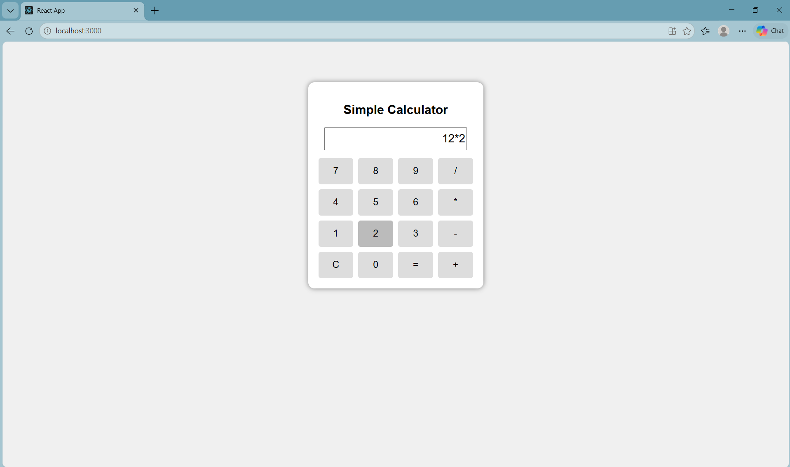
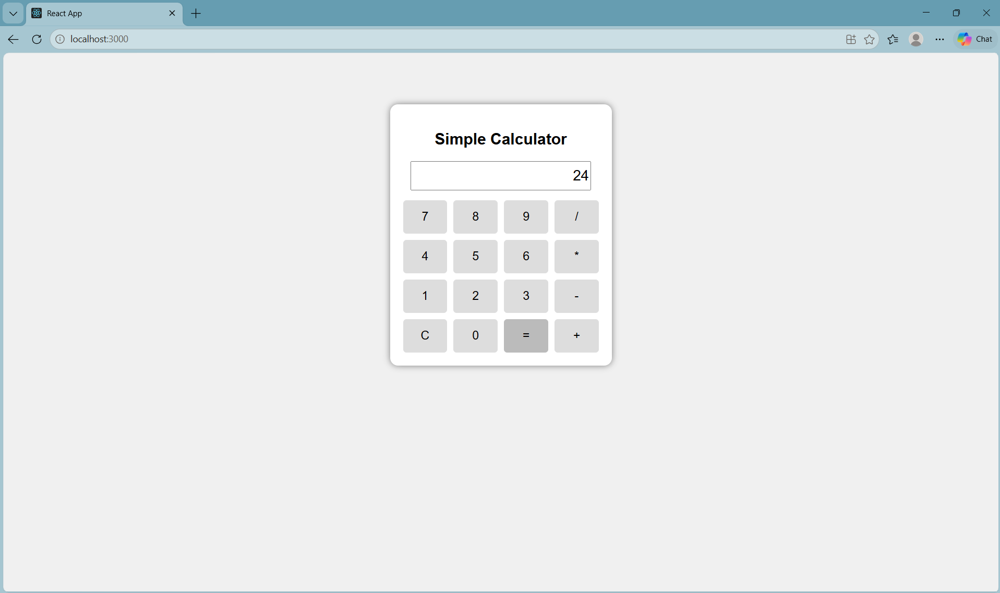

# Ex04 Simple Calculator - React Project
## Date:14-03-2026
## Name : CHITTOOR SARAVANA MRUDHULA
## Reg No : 212224040056

## AIM
To  develop a Simple Calculator using React.js with clean and responsive design, ensuring a smooth user experience across different screen sizes.

## ALGORITHM
### STEP 1
Create a React App.

### STEP 2
Open a terminal and run:
  <ul><li>npx create-react-app simple-calculator</li>
  <li>cd simple-calculator</li>
  <li>npm start</li></ul>

### STEP 3
Inside the src/ folder, create a new file Calculator.js and define the basic structure.

### STEP 4
Plan the UI: Display screen, number buttons (0-9), operators (+, -, *, /), clear (C), and equal (=).

### STEP 5
Create a new file Calculator.css in src/ and add the styling.

### STEP 6
Open src/App.js and modify it.

### STEP 7
Start the development server.
  npm start

### STEP 8
Open http://localhost:3000/ in the browser.

### STEP 9
Test the calculator by entering numbers and operations.

### STEP 10
Fix styling issues and refine content placement.

### STEP 11
Deploy the website.

### STEP 12
Upload to GitHub Pages for free hosting.

## PROGRAM

### Calculator.js

```

import React, { useState } from "react";
import "./Calculator.css";

function Calculator() {
  const [value, setValue] = useState("");

  const clickButton = (btn) => {
    if (btn === "C") {
      setValue("");
    } else if (btn === "=") {
      try {
        setValue(String(eval(value)));
      } catch {
        setValue("Error");
      }
    } else {
      setValue(value + btn);
    }
  };

  const buttons = [
    "7", "8", "9", "/",
    "4", "5", "6", "*",
    "1", "2", "3", "-",
    "C", "0", "=", "+"
  ];

  return (
    <div className="calculator">
      <h2>Simple Calculator</h2>
      <input value={value} readOnly />
      <div className="buttons">
        {buttons.map((btn) => (
          <button key={btn} onClick={() => clickButton(btn)}>
            {btn}
          </button>
        ))}
      </div>
    </div>
  );
}

export default Calculator;

```


### Calculator.css

```

body {
  background: #f0f0f0;
  font-family: Arial;
}

.calculator {
  width: 300px;
  margin: 80px auto;
  padding: 20px;
  background: white;
  border-radius: 12px;
  box-shadow: 0 0 10px gray;
  text-align: center;
}

input {
  width: 90%;
  height: 40px;
  margin-bottom: 15px;
  font-size: 22px;
  text-align: right;
}

.buttons {
  display: grid;
  grid-template-columns: repeat(4, 1fr);
  gap: 10px;
}

button {
  padding: 15px;
  font-size: 18px;
  border: none;
  background: #ddd;
  border-radius: 5px;
  cursor: pointer;
}

button:hover {
  background: #bbb;
}

```

### App.js

```
import Calculator from "./Calculator";

function App() {
  return (
    <div>
      <Calculator />
    </div>
  );
}

export default App;

```


## OUTPUT

### input :

### output :


## RESULT
The program for developing a simple calculator in React.js is executed successfully.